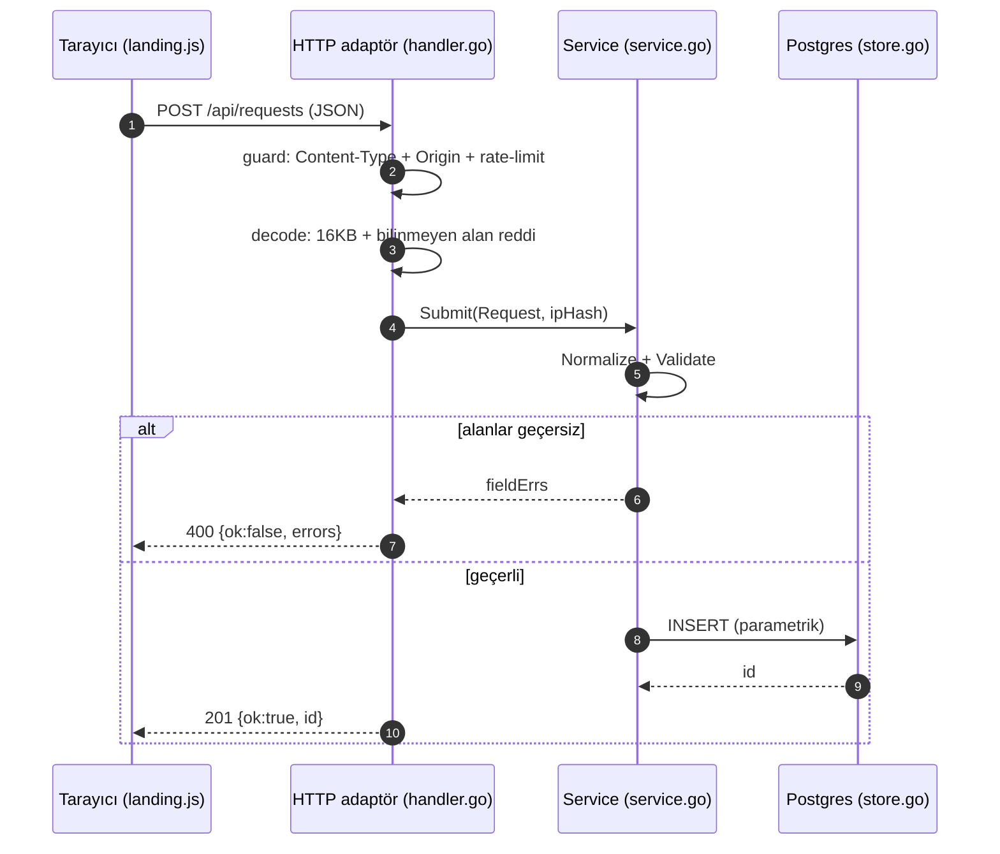

# WORKFLOW.md — opadm akışları

Bu dosya, sistemin **uçtan uca akışını net biçimde incelenebilir** kılar: talep
formu, oturum, canlı demo, güvenlik katmanları, AI ile geliştirme döngüsü ve
CI/dağıtım. Her adım bir **dosya + fonksiyon** referansı verir; referansları
takip ederek kodu satır satır izleyebilirsin.

> Hızlı rota: **§1** (form akışı) → **§4** (güvenlik nerede) → **§7** (nasıl
> incelenir). Görseller GFM/Mermaid destekleyen görüntüleyicide (GitHub) render
> olur; terminalden okunacaksa ASCII şemalar da var.

---

## 1. Çalışma zamanı akışı — talep formu (ana teslim)

```
Tarayıcı (web/landing.js)
   │  submit → validate() (istemci ön-doğrulama, yalnız UX)
   │  fetch POST /api/requests  (JSON)
   ▼
main.go  mux: "POST /api/requests" → App.Create
   │  middleware zinciri: recoverPanic(securityHeaders(mux))
   ▼
App.guard         (http/handler.go)   Content-Type + Origin/Referer + hız limiti
App.decode        (http/handler.go)   MaxBytesReader 16KB + DisallowUnknownFields
   ▼
Service.Submit    (application/service.go)
   │  Request.Normalize()  → kırp + e-posta küçük harf      (domain/request.go)
   │  Request.Validate()   → alan kuralları, fieldErrs map   (domain/request.go)
   ▼  (fieldErrs varsa 400, kayıt YOK)
Store.Insert      (infrastructure/postgres/store.go)   parametrik SQL ($1..$5)
   │  RETURNING id
   ▼
201 {"ok":true,"id":N}  → landing.js başarıyı YALNIZ bu yanıtta gösterir
   · DB hatası → 500 {"ok":false,...}, başarı işareti yok
   · her yeni kayıtta App.pushLive() → /api/live izleyicilerine anlık itme
```

Kritik garanti: **başarı mesajı yalnızca INSERT commit edip `id` döndüğünde**
gösterilir. İkinci savunma DB tarafındadır: `supabase/migrations/001_*.sql`
içindeki `CHECK` kısıtları aynı kuralları uygular.

### Akış şeması



---

## 2. Oturum / üyelik akışı

```
/signup/  (web/auth.js) ─┐
/login/   (web/auth.js) ─┴─ fetch POST /api/auth/{signup|login} (JSON)
                                 │
main.go mux → App.Signup / App.Login      (infrastructure/http/auth.go)
                                 │
Service.Signup / Service.Login            (application/auth.go)
   · Signup: e-posta + parola kuralları → bcrypt özeti → AuthStore.CreateUser
   · Login : AuthStore.FindUserByEmail → bcrypt.CompareHashAndPassword
             → rastgele jeton → DB'ye yalnız SHA-256 ÖZETİ (hashToken)
   · Başarı: App.setSession → opadm_session çerezi (HttpOnly, SameSite=Lax, 7 gün)
                                 │
GET /api/auth/me → App.Me → currentUser → Service.Me   (çerez → e-posta)
POST /api/auth/logout → Service.Logout (jeton özeti silinir) + çerez temizlenir
```

Kapılar: `/panel/` (web/panel.js) açılışta `/api/auth/me`'ye bakar; giriş yoksa
`/login/`'e yönlendirir. `/api/status`, `/api/demo`, `/api/live` de giriş ister
(401).

---

## 3. Canlı durum ve demo akışı

```
/panel/  (web/panel.js)
  ├─ "Canlı durum":  GET /api/status  (giriş ister)  → App.Status → Service.Snapshot
  │                  + WebSocket /api/live → App.Live → live.Hub (5 sn ticker + push)
  │                  soket kurulamazsa fetch'e düşer (Vercel'de 501)
  └─ "Canlı demo":   GET /api/demo (giriş ister) → App.Demo → Service.RunDemo
        summary: uptime, requests_total, last_request_at, write_latency_ms,
                 db_latency_us, submissions_ok/failed, error_rate_pct
        checks : 8 kontrol, gruplu (Ürün / Mühendislik), her biri
                 name + why + group + pass + detail  (iz bırakmaz, kota yakmaz)
```

`RunDemo` gerçek iş yapar: doğrulama örnekleri, gerçek yaz→oku→sil turu
(`Store.FullCycle`, kalıcı iz bırakmaz), gerçek bcrypt turu, probe ile hız limiti
deltası. Sahte "her şey yeşil" üretmez.

---

## 4. Güvenlik katmanları — nerede devreye girer

| Katman | Yer | Ne yapar |
|--------|-----|----------|
| Güvenlik başlıkları | `main.go` `securityHeaders` | CSP (same-origin), nosniff, DENY, no-referrer |
| Panic koruması | `main.go` `recoverPanic` | panik → 500, süreç ayakta |
| Gövde sınırı | `handler.go` `decode` | `MaxBytesReader` 16KB + `DisallowUnknownFields` |
| Zarf | `handler.go` `guard` | `Content-Type: application/json` zorunlu (415) |
| CSRF | `domain.AllowedOrigin` | Origin/Referer Host eşleşmezse 403 |
| Hız limiti | `ratelimit.Limiter.Allow` | IP başına 10 istek/dk (429) |
| Girdi kuralları | `domain.Request.Validate` | name/email/service/message |
| SQL | `store.go` `Insert` | parametrik sorgu ($1..), injection yok |
| IP gizliliği | `handler.go` `hashIP` | ham IP değil SHA-256 özeti |
| Parola/oturum | `application/auth.go` | bcrypt özeti; jetonun DB'de SHA-256 özeti |
| Çerez | `http/auth.go` `setSession` | HttpOnly + SameSite=Lax (+Secure HTTPS'te) |
| DB ikinci savunma | `supabase/migrations/*.sql` | CHECK kısıtları + RLS (anon politika yok) |

---

## 5. Geliştirme (AI) akışı

```
plan (gereksinimleri/sınırları netleştir)
   → üret (katmanlı: domain → application → infrastructure → web)
   → doğrula (go vet · go test -race · gerçek DB ile E2E · node --check)
   → düzelt (kök nedeni düzelt, testi zayıflatma)
   → kaydet (AI_LOG.md: karar, komut, GERÇEK çıktı; uydurma hata/başarı yok)
```

Ayrıntılı karar ve doğrulama kaydı: [AI_LOG.md](./AI_LOG.md). Değişmez kural:
doğrulanmayan bir iddia yazılmaz; yapılmayan doğrulama "yapılmadı" olarak yazılır.

---

## 6. CI ve dağıtım akışı

```
push / PR
   └─ .github/workflows/ci.yml
        ├─ go vet ./...
        ├─ go test -race ./...      (entegrasyon testi DB yoksa kendi kendine atlar)
        ├─ go build -trimpath ./...
        └─ node --check web/*.js
```

Dağıtım (iki yol):

```
A) Vercel (serverless) + Supabase Postgres
   vercel.json: framework=null · outputDirectory=web · rewrites /api/* → /api/index
   Statik: web/ (Vercel)  ·  API: api/index.go (tek giriş)
      sync.Once → httphandler.NewFromEnv() → App.RegisterRoutes(mux) → mux
      Rotalar main.go ile AYNI haritadan; iki ortamda fark olmaz.
   Not: /api/live serverless'ta 501 döner; istemci fetch'e düşer.

B) Tek süreç (Docker / systemd / yerel)
   main.go → gömülü web/ + tüm rotalar + live.Hub (soket gerçekten çalışır)
   docker compose up -d --build  (app + postgres, migration'lar ilk init'te)
```

---

## 7. Nasıl incelenir (adım adım)

1. **Akışı oku:** bu dosya §1–§4 — her adım bir dosya/fonksiyon verir.
2. **Kodu aç:** `web/landing.js` → `internal/infrastructure/http/handler.go`
   (`Create`/`guard`/`decode`) → `internal/application/service.go` (`Submit`)
   → `internal/infrastructure/postgres/store.go` (`Insert`).
3. **Doğrula (DB'siz):**
   ```sh
   go vet ./... && go test -race ./...
   ```
4. **Gerçek kayıt akışını izle:** Postgres'i ayağa kaldır, migration'ları uygula,
   `go run .`, sonra:
   ```sh
   curl -i -X POST localhost:8080/api/requests -H 'Content-Type: application/json' \
     -d '{"name":"Ad Soyad","email":"a@b.co","service":"backup","message":"on karakterden uzun mesaj"}'
   # → 201 {"ok":true,"id":N}  ·  aynı isteği bozuk e-posta ile → 400, kayıt yok
   ```
5. **Kanıtı sunucuda doğrula:** `SELECT * FROM requests;` (yalnız test verisi).
6. **CI'yi gör:** `.github/workflows/ci.yml` — aynı kontroller her push'ta koşar.

---

### İlgili dosyalar
`README.md` (teslim + kurulum) · `AI_LOG.md` (AI karar/doğrulama kaydı) ·
`supabase/migrations/*.sql` (şema + kısıtlar) · `.github/workflows/ci.yml` (CI).
