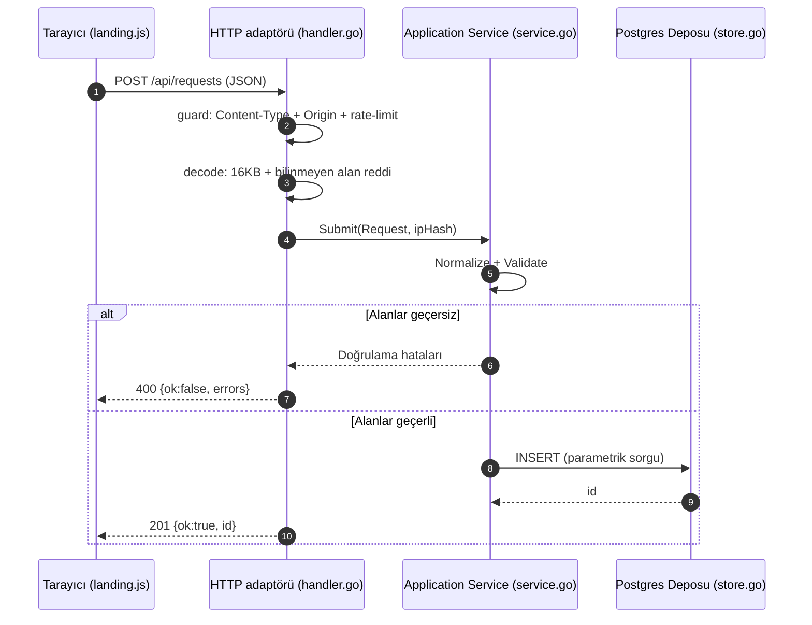

# WORKFLOW.md — opadm akışları

Bu dosya sistemin uçtan uca veri ve kontrol akışlarını dosya ve fonksiyon referanslarıyla açıklar.

---

## 1. Talep Formu Akışı

```text
Tarayıcı (web/landing.js)
   │  submit → validate() (istemci ön doğrulaması, salt UX)
   │  fetch POST /api/requests  (JSON)
   ▼
main.go (mux: "POST /api/requests" → App.Create)
   │  middleware: recoverPanic(securityHeaders(mux))
   ▼
App.guard         (pkg/infrastructure/http/handler.go)   Content-Type + Origin/Referer + hız limiti
App.decode        (pkg/infrastructure/http/handler.go)   MaxBytesReader 16KB + DisallowUnknownFields
   ▼
Service.Submit    (pkg/application/service.go)
   │  Request.Normalize()  → boşluk kırpma + küçük harf e-posta (pkg/domain/request.go)
   │  Request.Validate()   → girdi kısıtları, hata haritası    (pkg/domain/request.go)
   ▼  (alanlar geçersizse 400 döner, kayıt oluşmaz)
Store.Insert      (pkg/infrastructure/postgres/store.go)  parametrik SQL ($1..$5)
   │  RETURNING id
   ▼
201 {"ok":true, "id":N}  → landing.js başarı mesajını yalnız bu yanıtta gösterir
   · Veritabanı hatası → 500 {"ok":false}, başarı gösterilmez
   · Başarılı kayıtta App.pushLive() → /api/live dinleyicilerine telemetri iletir
```

Garanti: **Başarı bildirimi yalnızca INSERT işlemi commit edilip pozitif `id` döndüğünde gösterilir.** Veritabanı katmanında `CHECK` kısıtları aynı kuralları bağımsız olarak zorunlu tutar.

### Sıralı Akış Şeması



---

## 2. Oturum ve Kimlik Doğrulama Akışı

```text
/signup/  (web/auth.js) ─┐
/login/   (web/auth.js) ─┴─ fetch POST /api/auth/{signup|login} (JSON)
                                 │
main.go mux → App.Signup / App.Login      (pkg/infrastructure/http/auth.go)
                                 │
Service.Signup / Service.Login            (pkg/application/auth.go)
   · Kayıt: e-posta ve parola kuralları → bcrypt özeti → AuthStore.CreateUser
   · Giriş: AuthStore.FindUserByEmail → bcrypt karşılaştırma
             → rastgele oturum anahtarı → veritabanına SHA-256 hash'i yazılır
   · Başarı: App.setSession → opadm_session çerezi (HttpOnly, SameSite=Lax, 7 gün)
                                 │
GET /api/auth/me → App.Me → Service.Me (çerez doğrulanır, e-posta döner)
POST /api/auth/logout → Service.Logout (oturum silinir, çerez temizlenir)
```

Giriş koruması: `/panel/` açılışta `/api/auth/me` durumunu denetler; oturum yoksa `/login/` sayfasına yönlendirir. `/api/status`, `/api/demo` ve `/api/live` uç noktaları da yetkisiz çağrılarda HTTP 401 döner.

---

## 3. Canlı Durum ve Demo Akışı

```text
/panel/  (web/panel.js)
  ├─ Canlı Durum: GET /api/status (oturum gerekir) → App.Status → Service.Snapshot
  │               + WebSocket /api/live → App.Live → live.Hub (5 sn aralıkla bildirim)
  │               (Vercel ortamında 501 döner, istemci doğrudan HTTP sorgular)
  └─ Canlı Demo:  GET /api/demo (oturum gerekir) → App.Demo → Service.RunDemo
        summary: uptime, requests_total, last_request_at, write_latency_ms, db_latency_us
        checks : 8 adet sistem kontrolü (Ürün / Mühendislik grupları)
```

`RunDemo` sunucuda anlık kontrol yürütür: doğrulama kuralları, geçici yaz→oku→sil döngüsü (`Store.FullCycle`, test verisi temizlenir), bcrypt çalıştırma süresi ve hız sınırlayıcı davranışı.

---

## 4. Güvenlik Katmanları

| Katman | Konum | İşlev |
|---|---|---|
| Güvenlik Başlıkları | `main.go` `securityHeaders` | `Content-Security-Policy: default-src 'self'`, nosniff, DENY, no-referrer |
| Hata Yakalama | `main.go` `recoverPanic` | Beklenmeyen panik durumunda 500 döner, ana süreç ayakta kalır |
| Gövde Sınırı | `pkg/infrastructure/http/handler.go` | `http.MaxBytesReader` ile 16 KB sınırı ve `DisallowUnknownFields` |
| Zarf Doğrulaması | `pkg/infrastructure/http/handler.go` | `Content-Type: application/json` zorunluluğu (aksi halde 415) |
| CSRF Koruması | `pkg/domain/request.go` | Origin ve Referer başlıklarının Host ile eşleşme denetimi (403) |
| Hız Sınırlayıcı | `pkg/infrastructure/ratelimit/` | IP başına dakikada 10 istek sınırı (429) |
| Girdi Kuralları | `pkg/domain/request.go` | Alan uzunluk ve biçim denetimleri |
| SQL Güvenliği | `pkg/infrastructure/postgres/store.go` | Parametrik sorgular (`$1, $2`), SQL injection engeli |
| IP Gizliliği | `pkg/infrastructure/http/handler.go` | Ham IP yerine SHA-256 hash'i (`ip_hash`) saklanır |
| Parola Güvenliği | `pkg/application/auth.go` | bcrypt ile şifreleme |
| Oturum Çerezi | `pkg/infrastructure/http/auth.go` | HttpOnly ve SameSite=Lax bayrakları |
| Veritabanı Kısıtları | `supabase/migrations/*.sql` | Tablo seviyesinde `CHECK` kuralları ve Row Level Security (RLS) |

---

## 5. Doğrulama ve İnceleme Sırası

1. **Birim testleri:**
   ```sh
   go vet ./... && go test -race ./...
   ```
2. **Kayıt akışının yerel testi:**
   Veritabanını başlatın, migration'ları çalıştırın ve uygulamayı açın:
   ```sh
   curl -i -X POST localhost:8080/api/requests -H 'Content-Type: application/json' \
     -d '{"name":"Test Kullanici","email":"test@ornek.com","service":"backup","message":"Sunucu durum bilgisi aciklamasi."}'
   # 201 {"id":1, "ok":true} döner; geçersiz e-postada 400 döner ve kayıt oluşmaz.
   ```
3. **Veritabanı denetimi:**
   `SELECT * FROM requests;` ile kaydın oluştuğu doğrulanır.
